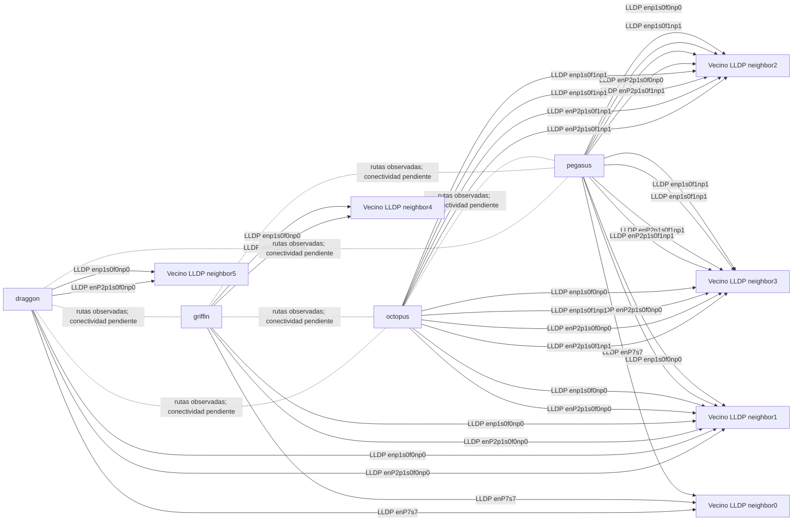

# Inventario distribuido

- Corrida: `20261031T224804.348141Z-af026390`; estado: **complete**.
- Commit: `a73350a5b335774e3463284a3565ec8bb264ba8d`; dirty: `True`.
- Generador del informe: `infraestructura/cluster_inventory.py`; SHA-256: `e66ffd23c587928804aeae41feb05120b1b66475c2411d3751bfdd48ab78ea14`.
- El commit y la configuración declarada corresponden a la captura; el generador puede ser posterior.
- Las direcciones de configuración son declaradas. El inventario no verifica reposo ni readiness NCCL.

| Nodo | Host esperado | Host observado | GPU UUID observado | Estado |
| --- | --- | --- | --- | --- |
| pegasus | spark-cfea | spark-cfea | GPU-d2718ffa-1726-8960-32fb-0a5941e62a39 | observado |
| octopus | spark-60c3 | spark-60c3 | GPU-3e910dc4-733f-1f24-8432-b3dc495bb57f | observado |
| griffin | gx10-726d | gx10-726d | GPU-9db8883f-ccef-fc02-2bd3-8e2faf0689af | observado |
| draggon | spark-192d | spark-192d | GPU-6c8dd3e3-3431-28c9-8643-ae76add329b0 | observado |

## Hardware y sistema observados

| Nodo | Fabricante DMI | Modelo DMI | CPU | Memoria MemTotal | GPU/driver | SO | Discos |
| --- | --- | --- | --- | --- | --- | --- | --- |
| pegasus | NVIDIA | NVIDIA_DGX_Spark | Cortex-X925 + Cortex-A725 (20 CPU lógicas) | MemTotal:       127600748 kB | NVIDIA GB10, GPU-d2718ffa-1726-8960-32fb-0a5941e62a39, [N/A], 580.173.02 | Ubuntu 24.04.4 LTS | nvme0n1: SAMSUNG MZALC4T0HBL1-00B07 (4096805658624 bytes) |
| octopus | NVIDIA | NVIDIA_DGX_Spark | Cortex-X925 + Cortex-A725 (20 CPU lógicas) | MemTotal:       125483612 kB | NVIDIA GB10, GPU-3e910dc4-733f-1f24-8432-b3dc495bb57f, [N/A], 580.173.02 | Ubuntu 24.04.4 LTS | nvme0n1: SAMSUNG MZALC4T0HBL1-00B07 (4096805658624 bytes) |
| griffin | ASUSTeK COMPUTER INC. | GX10 | Cortex-X925 + Cortex-A725 (20 CPU lógicas) | MemTotal:       127533168 kB | NVIDIA GB10, GPU-9db8883f-ccef-fc02-2bd3-8e2faf0689af, [N/A], 580.178.04 | Ubuntu 24.04.5 LTS | nvme0n1: ESL01TBTLCZ-27J2-TYN (1000204886016 bytes) |
| draggon | NVIDIA | NVIDIA_DGX_Spark | Cortex-X925 + Cortex-A725 (20 CPU lógicas) | MemTotal:       127598544 kB | NVIDIA GB10, GPU-6c8dd3e3-3431-28c9-8643-ae76add329b0, [N/A], 580.178.04 | Ubuntu 24.04.5 LTS | nvme0n1: SAMSUNG MZALC4T0HBL1-00B07 (4096805658624 bytes) |

## Acceso y red

| Nodo | Acceso declarado | Resultado colector observado | Interfaces observadas (velocidad/MTU/estado) | Firmware NIC | RDMA/mapeo | Almacenamiento disponible |
| --- | --- | --- | --- | --- | --- | --- |
| pegasus | `local`; local | exit 0 | docker0 (velocidad desconocida; MTU 1500; estado down); enP2p1s0f0np0 (200000 Mb/s; MTU 9000; estado up); enP2p1s0f1np1 (200000 Mb/s; MTU 1500; estado up); enP7s7 (1000 Mb/s; MTU 1500; estado up); enp1s0f0np0 (200000 Mb/s; MTU 9000; estado up); enp1s0f1np1 (200000 Mb/s; MTU 1500; estado up); lo (velocidad desconocida; MTU 65536; estado unknown); wlP9s9 (velocidad desconocida; MTU 1500; estado down); wt0 (velocidad desconocida; MTU 1280; estado unknown) | docker0: N/A; enP2p1s0f0np0: 28.45.4028 (NVD0000000087); enP2p1s0f1np1: 28.45.4028 (NVD0000000087); enP7s7: ; enp1s0f0np0: 28.45.4028 (NVD0000000087); enp1s0f1np1: 28.45.4028 (NVD0000000087); wlP9s9: ____000000-20251210093025; wt0:  | 0002:01:00.0 roceP2p1s0f0 (MT4129 -            )                 fw 28.45.4028 port 1 (ACTIVE) ==> enP2p1s0f0np0 (Up); 0002:01:00.1 roceP2p1s0f1 (MT4129 -            )                 fw 28.45.4028 port 1 (ACTIVE) ==> enP2p1s0f1np1 (Up); 0000:01:00.0 rocep1s0f0 (MT4129 -            )                 fw 28.45.4028 port 1 (ACTIVE) ==> enp1s0f0np0 (Up); 0000:01:00.1 rocep1s0f1 (MT4129 -            )                 fw 28.45.4028 port 1 (ACTIVE) ==> enp1s0f1np1 (Up) | 3135808180224 bytes libres en / |
| octopus | `ssh -p 22 bastiangl@192.168.100.11`; ssh_previously_confirmed_management_no_route_data_addresses_declared | exit 0 | docker0 (velocidad desconocida; MTU 1500; estado down); enP2p1s0f0np0 (200000 Mb/s; MTU 9000; estado up); enP2p1s0f1np1 (200000 Mb/s; MTU 1500; estado up); enP7s7 (velocidad desconocida; MTU 1500; estado down); enp1s0f0np0 (200000 Mb/s; MTU 9000; estado up); enp1s0f1np1 (200000 Mb/s; MTU 1500; estado up); lo (velocidad desconocida; MTU 65536; estado unknown); wlP9s9 (velocidad desconocida; MTU 1500; estado down); wt0 (velocidad desconocida; MTU 1280; estado unknown) | docker0: N/A; enP2p1s0f0np0: 28.45.4028 (NVD0000000087); enP2p1s0f1np1: 28.45.4028 (NVD0000000087); enP7s7: ; enp1s0f0np0: 28.45.4028 (NVD0000000087); enp1s0f1np1: 28.45.4028 (NVD0000000087); wlP9s9: ____000000-20251210093025; wt0:  | 0002:01:00.0 roceP2p1s0f0 (MT4129 -            )                 fw 28.45.4028 port 1 (ACTIVE) ==> enP2p1s0f0np0 (Up); 0002:01:00.1 roceP2p1s0f1 (MT4129 -            )                 fw 28.45.4028 port 1 (ACTIVE) ==> enP2p1s0f1np1 (Up); 0000:01:00.0 rocep1s0f0 (MT4129 -            )                 fw 28.45.4028 port 1 (ACTIVE) ==> enp1s0f0np0 (Up); 0000:01:00.1 rocep1s0f1 (MT4129 -            )                 fw 28.45.4028 port 1 (ACTIVE) ==> enp1s0f1np1 (Up) | 3424150441984 bytes libres en / |
| griffin | `ssh -p 22 bastiangl@146.155.13.134`; host_key_unknown_authentication_pending | exit 0 | docker0 (velocidad desconocida; MTU 1500; estado down); enP2p1s0f0np0 (200000 Mb/s; MTU 9000; estado up); enP2p1s0f1np1 (velocidad desconocida; MTU 1500; estado down); enP7s7 (1000 Mb/s; MTU 1500; estado up); enp1s0f0np0 (200000 Mb/s; MTU 9000; estado up); enp1s0f1np1 (velocidad desconocida; MTU 1500; estado down); lo (velocidad desconocida; MTU 65536; estado unknown); wlP9s9 (velocidad desconocida; MTU 1500; estado down) | docker0: N/A; enP2p1s0f0np0: 28.45.4028 (NVD0000000087); enP2p1s0f1np1: 28.45.4028 (NVD0000000087); enP7s7: ; enp1s0f0np0: 28.45.4028 (NVD0000000087); enp1s0f1np1: 28.45.4028 (NVD0000000087); wlP9s9: ____000000-20260605184805 | 0002:01:00.0 roceP2p1s0f0 (MT4129 -            )                 fw 28.45.4028 port 1 (ACTIVE) ==> enP2p1s0f0np0 (Up); 0002:01:00.1 roceP2p1s0f1 (MT4129 -            )                 fw 28.45.4028 port 1 (DOWN  ) ==> enP2p1s0f1np1 (Down); 0000:01:00.0 rocep1s0f0 (MT4129 -            )                 fw 28.45.4028 port 1 (ACTIVE) ==> enp1s0f0np0 (Up); 0000:01:00.1 rocep1s0f1 (MT4129 -            )                 fw 28.45.4028 port 1 (DOWN  ) ==> enp1s0f1np1 (Down) | 812983009280 bytes libres en / |
| draggon | `ssh -p 22 bastiangl@146.155.13.135`; host_key_unknown_authentication_pending | exit 0 | docker0 (velocidad desconocida; MTU 1500; estado down); enP2p1s0f0np0 (200000 Mb/s; MTU 9000; estado up); enP2p1s0f1np1 (velocidad desconocida; MTU 1500; estado down); enP7s7 (1000 Mb/s; MTU 1500; estado up); enp1s0f0np0 (200000 Mb/s; MTU 9000; estado up); enp1s0f1np1 (velocidad desconocida; MTU 1500; estado down); lo (velocidad desconocida; MTU 65536; estado unknown); wlP9s9 (velocidad desconocida; MTU 1500; estado down) | docker0: N/A; enP2p1s0f0np0: 28.50.1002 (NVD0000000087); enP2p1s0f1np1: 28.50.1002 (NVD0000000087); enP7s7: ; enp1s0f0np0: 28.50.1002 (NVD0000000087); enp1s0f1np1: 28.50.1002 (NVD0000000087); wlP9s9: ____000000-20260605184805 | 0002:01:00.0 roceP2p1s0f0 (MT4129 -            )                 fw 28.50.1002 port 1 (ACTIVE) ==> enP2p1s0f0np0 (Up); 0002:01:00.1 roceP2p1s0f1 (MT4129 -            )                 fw 28.50.1002 port 1 (DOWN  ) ==> enP2p1s0f1np1 (Down); 0000:01:00.0 rocep1s0f0 (MT4129 -            )                 fw 28.50.1002 port 1 (ACTIVE) ==> enp1s0f0np0 (Up); 0000:01:00.1 rocep1s0f1 (MT4129 -            )                 fw 28.50.1002 port 1 (DOWN  ) ==> enp1s0f1np1 (Down) | 3706402488320 bytes libres en / |

## Versiones de software observadas

| Nodo | Kernel | CUDA compiler | NCCL packages | PCI inventory |
| --- | --- | --- | --- | --- |
| pegasus | 6.17.0-1029-nvidia | Cuda compilation tools, release 13.0, V13.0.88 | ningún paquete NCCL registrado por dpkg | lspci registrado en raw |
| octopus | 6.17.0-1029-nvidia | desconocido | ningún paquete NCCL registrado por dpkg | lspci registrado en raw |
| griffin | 7.0.0-1019-nvidia | desconocido | ningún paquete NCCL registrado por dpkg | lspci registrado en raw |
| draggon | 7.0.0-1019-nvidia | desconocido | ningún paquete NCCL registrado por dpkg | lspci registrado en raw |

La consulta dpkg no determina si libnccl está instalada fuera de paquetes dpkg.

## Sondas sin resultado

- `pegasus.interfaces.value.docker0.device/vendor`: missing.
- `pegasus.interfaces.value.docker0.device/device`: missing.
- `pegasus.interfaces.value.docker0.device/firmware_node/path`: missing.
- `pegasus.interfaces.value.enP2p1s0f0np0.device/firmware_node/path`: missing.
- `pegasus.interfaces.value.enP2p1s0f1np1.device/firmware_node/path`: missing.
- `pegasus.interfaces.value.enP7s7.device/firmware_node/path`: missing.
- `pegasus.interfaces.value.enp1s0f1np1.device/firmware_node/path`: missing.
- `pegasus.interfaces.value.lo.speed`: error.
- `pegasus.interfaces.value.lo.duplex`: error.
- `pegasus.interfaces.value.lo.device/vendor`: missing.
- `pegasus.interfaces.value.lo.device/device`: missing.
- `pegasus.interfaces.value.lo.device/firmware_node/path`: missing.
- `pegasus.interfaces.value.wlP9s9.speed`: error.
- `pegasus.interfaces.value.wlP9s9.duplex`: error.
- `pegasus.interfaces.value.wt0.speed`: error.
- `pegasus.interfaces.value.wt0.duplex`: error.
- `pegasus.interfaces.value.wt0.device/vendor`: missing.
- `pegasus.interfaces.value.wt0.device/device`: missing.
- `pegasus.interfaces.value.wt0.device/firmware_node/path`: missing.
- `pegasus.nic_firmware.lo`: error.
- `pegasus.nic_link.wt0`: error.
- `octopus.interfaces.value.docker0.device/vendor`: missing.
- `octopus.interfaces.value.docker0.device/device`: missing.
- `octopus.interfaces.value.docker0.device/firmware_node/path`: missing.
- `octopus.interfaces.value.enP2p1s0f0np0.device/firmware_node/path`: missing.
- `octopus.interfaces.value.enP2p1s0f1np1.device/firmware_node/path`: missing.
- `octopus.interfaces.value.enP7s7.device/firmware_node/path`: missing.
- `octopus.interfaces.value.enp1s0f1np1.device/firmware_node/path`: missing.
- `octopus.interfaces.value.lo.speed`: error.
- `octopus.interfaces.value.lo.duplex`: error.
- `octopus.interfaces.value.lo.device/vendor`: missing.
- `octopus.interfaces.value.lo.device/device`: missing.
- `octopus.interfaces.value.lo.device/firmware_node/path`: missing.
- `octopus.interfaces.value.wlP9s9.speed`: error.
- `octopus.interfaces.value.wlP9s9.duplex`: error.
- `octopus.interfaces.value.wt0.speed`: error.
- `octopus.interfaces.value.wt0.duplex`: error.
- `octopus.interfaces.value.wt0.device/vendor`: missing.
- `octopus.interfaces.value.wt0.device/device`: missing.
- `octopus.interfaces.value.wt0.device/firmware_node/path`: missing.
- `octopus.cuda_compiler`: missing.
- `octopus.nic_firmware.lo`: error.
- `octopus.nic_link.wt0`: error.
- `griffin.interfaces.value.docker0.device/vendor`: missing.
- `griffin.interfaces.value.docker0.device/device`: missing.
- `griffin.interfaces.value.docker0.device/firmware_node/path`: missing.
- `griffin.interfaces.value.enP2p1s0f0np0.device/firmware_node/path`: missing.
- `griffin.interfaces.value.enP2p1s0f1np1.device/firmware_node/path`: missing.
- `griffin.interfaces.value.enP7s7.device/firmware_node/path`: missing.
- `griffin.interfaces.value.enp1s0f1np1.device/firmware_node/path`: missing.
- `griffin.interfaces.value.lo.speed`: error.
- `griffin.interfaces.value.lo.duplex`: error.
- `griffin.interfaces.value.lo.device/vendor`: missing.
- `griffin.interfaces.value.lo.device/device`: missing.
- `griffin.interfaces.value.lo.device/firmware_node/path`: missing.
- `griffin.interfaces.value.wlP9s9.speed`: error.
- `griffin.interfaces.value.wlP9s9.duplex`: error.
- `griffin.cuda_compiler`: missing.
- `griffin.nic_firmware.lo`: error.
- `draggon.interfaces.value.docker0.device/vendor`: missing.
- `draggon.interfaces.value.docker0.device/device`: missing.
- `draggon.interfaces.value.docker0.device/firmware_node/path`: missing.
- `draggon.interfaces.value.enP2p1s0f0np0.device/firmware_node/path`: missing.
- `draggon.interfaces.value.enP2p1s0f1np1.device/firmware_node/path`: missing.
- `draggon.interfaces.value.enP7s7.device/firmware_node/path`: missing.
- `draggon.interfaces.value.enp1s0f1np1.device/firmware_node/path`: missing.
- `draggon.interfaces.value.lo.speed`: error.
- `draggon.interfaces.value.lo.duplex`: error.
- `draggon.interfaces.value.lo.device/vendor`: missing.
- `draggon.interfaces.value.lo.device/device`: missing.
- `draggon.interfaces.value.lo.device/firmware_node/path`: missing.
- `draggon.interfaces.value.wlP9s9.speed`: error.
- `draggon.interfaces.value.wlP9s9.duplex`: error.
- `draggon.cuda_compiler`: missing.
- `draggon.nic_firmware.lo`: error.

## Vecinos LLDP observados

| Nodo | Interfaz local | Chassis ID anunciado | Nombre anunciado | Descripción chassis anunciada | Direcciones gestión anunciadas | Puerto remoto anunciado | Descripción puerto anunciada |
| --- | --- | --- | --- | --- | --- | --- | --- |
| pegasus | enP7s7 | c8:fe:6a:fb:57:91 | dc-2.ing.puc.cl | Juniper Networks, Inc. ex2300-48t Ethernet Switch, kernel JUNOS 18.2R3-S4.1, Build date: 2020-04-17 04:37:38 UTC Copyright (c) 1996-2020 Juniper Networks, Inc. | desconocido | 523 | ge-0/0/9 |
| pegasus | enp1s0f0np0 | d0:ea:11:02:79:d3 | MikroTik | MikroTik RouterOS 7.19.6 (stable) 2025-09-12 09:02:42 CRS804-4DDQ | 192.168.88.1, fe80::d2ea:11ff:fe02:79d3 | qsfp56-dd-1-1 | bridge/qsfp56-dd-1-1 |
| pegasus | enp1s0f0np0 | 4c:bb:47:29:cf:ea | spark-cfea | Ubuntu 24.04.4 LTS Linux 6.17.0-1029-nvidia #29-Ubuntu SMP PREEMPT_DYNAMIC Wed Jul  1 00:13:52 UTC 2026 aarch64 | 172.17.0.1, fdd1:eccf:8581:6581:b2bc:8acf:94a0:d77c | 4c:bb:47:29:cf:ef | enP2p1s0f0np0 |
| pegasus | enp1s0f1np1 | 4c:bb:47:2f:60:c3 | spark-60c3 | Ubuntu 24.04.4 LTS Linux 6.17.0-1029-nvidia #29-Ubuntu SMP PREEMPT_DYNAMIC Wed Jul  1 00:13:52 UTC 2026 aarch64 | 172.17.0.1, fdd1:eccf:8581:6581:9ae5:25ec:b6ad:e881 | 4c:bb:47:2f:60:c9 | enP2p1s0f1np1 |
| pegasus | enp1s0f1np1 | 4c:bb:47:2f:60:c3 | spark-60c3 | Ubuntu 24.04.4 LTS Linux 6.17.0-1029-nvidia #29-Ubuntu SMP PREEMPT_DYNAMIC Wed Jul  1 00:13:52 UTC 2026 aarch64 | 172.17.0.1, fdd1:eccf:8581:6581:9ae5:25ec:b6ad:e881 | 4c:bb:47:2f:60:c5 | enp1s0f1np1 |
| pegasus | enp1s0f1np1 | 4c:bb:47:29:cf:ea | spark-cfea | Ubuntu 24.04.4 LTS Linux 6.17.0-1029-nvidia #29-Ubuntu SMP PREEMPT_DYNAMIC Wed Jul  1 00:13:52 UTC 2026 aarch64 | 172.17.0.1, fdd1:eccf:8581:6581:b2bc:8acf:94a0:d77c | 4c:bb:47:29:cf:f0 | enP2p1s0f1np1 |
| pegasus | enP2p1s0f0np0 | d0:ea:11:02:79:d3 | MikroTik | MikroTik RouterOS 7.19.6 (stable) 2025-09-12 09:02:42 CRS804-4DDQ | 192.168.88.1, fe80::d2ea:11ff:fe02:79d3 | qsfp56-dd-1-1 | bridge/qsfp56-dd-1-1 |
| pegasus | enP2p1s0f0np0 | 4c:bb:47:29:cf:ea | spark-cfea | Ubuntu 24.04.4 LTS Linux 6.17.0-1029-nvidia #29-Ubuntu SMP PREEMPT_DYNAMIC Wed Jul  1 00:13:52 UTC 2026 aarch64 | 172.17.0.1, fdd1:eccf:8581:6581:b2bc:8acf:94a0:d77c | 4c:bb:47:29:cf:eb | enp1s0f0np0 |
| pegasus | enP2p1s0f1np1 | 4c:bb:47:2f:60:c3 | spark-60c3 | Ubuntu 24.04.4 LTS Linux 6.17.0-1029-nvidia #29-Ubuntu SMP PREEMPT_DYNAMIC Wed Jul  1 00:13:52 UTC 2026 aarch64 | 172.17.0.1, fdd1:eccf:8581:6581:9ae5:25ec:b6ad:e881 | 4c:bb:47:2f:60:c9 | enP2p1s0f1np1 |
| pegasus | enP2p1s0f1np1 | 4c:bb:47:2f:60:c3 | spark-60c3 | Ubuntu 24.04.4 LTS Linux 6.17.0-1029-nvidia #29-Ubuntu SMP PREEMPT_DYNAMIC Wed Jul  1 00:13:52 UTC 2026 aarch64 | 172.17.0.1, fdd1:eccf:8581:6581:9ae5:25ec:b6ad:e881 | 4c:bb:47:2f:60:c5 | enp1s0f1np1 |
| pegasus | enP2p1s0f1np1 | 4c:bb:47:29:cf:ea | spark-cfea | Ubuntu 24.04.4 LTS Linux 6.17.0-1029-nvidia #29-Ubuntu SMP PREEMPT_DYNAMIC Wed Jul  1 00:13:52 UTC 2026 aarch64 | 172.17.0.1, fdd1:eccf:8581:6581:b2bc:8acf:94a0:d77c | 4c:bb:47:29:cf:ec | enp1s0f1np1 |
| octopus | enp1s0f0np0 | d0:ea:11:02:79:d3 | MikroTik | MikroTik RouterOS 7.19.6 (stable) 2025-09-12 09:02:42 CRS804-4DDQ | 192.168.88.1, fe80::d2ea:11ff:fe02:79d3 | qsfp56-dd-1-5 | bridge/qsfp56-dd-1-5 |
| octopus | enp1s0f0np0 | 4c:bb:47:2f:60:c3 | spark-60c3 | Ubuntu 24.04.4 LTS Linux 6.17.0-1029-nvidia #29-Ubuntu SMP PREEMPT_DYNAMIC Wed Jul  1 00:13:52 UTC 2026 aarch64 | 172.17.0.1, fdd1:eccf:8581:6581:9ae5:25ec:b6ad:e881 | 4c:bb:47:2f:60:c8 | enP2p1s0f0np0 |
| octopus | enp1s0f1np1 | 4c:bb:47:2f:60:c3 | spark-60c3 | Ubuntu 24.04.4 LTS Linux 6.17.0-1029-nvidia #29-Ubuntu SMP PREEMPT_DYNAMIC Wed Jul  1 00:13:52 UTC 2026 aarch64 | 172.17.0.1, fdd1:eccf:8581:6581:9ae5:25ec:b6ad:e881 | 4c:bb:47:2f:60:c9 | enP2p1s0f1np1 |
| octopus | enp1s0f1np1 | 4c:bb:47:29:cf:ea | spark-cfea | Ubuntu 24.04.4 LTS Linux 6.17.0-1029-nvidia #29-Ubuntu SMP PREEMPT_DYNAMIC Wed Jul  1 00:13:52 UTC 2026 aarch64 | 172.17.0.1, fdd1:eccf:8581:6581:b2bc:8acf:94a0:d77c | 4c:bb:47:29:cf:ec | enp1s0f1np1 |
| octopus | enp1s0f1np1 | 4c:bb:47:29:cf:ea | spark-cfea | Ubuntu 24.04.4 LTS Linux 6.17.0-1029-nvidia #29-Ubuntu SMP PREEMPT_DYNAMIC Wed Jul  1 00:13:52 UTC 2026 aarch64 | 172.17.0.1, fdd1:eccf:8581:6581:b2bc:8acf:94a0:d77c | 4c:bb:47:29:cf:f0 | enP2p1s0f1np1 |
| octopus | enP2p1s0f0np0 | d0:ea:11:02:79:d3 | MikroTik | MikroTik RouterOS 7.19.6 (stable) 2025-09-12 09:02:42 CRS804-4DDQ | 192.168.88.1, fe80::d2ea:11ff:fe02:79d3 | qsfp56-dd-1-5 | bridge/qsfp56-dd-1-5 |
| octopus | enP2p1s0f0np0 | 4c:bb:47:2f:60:c3 | spark-60c3 | Ubuntu 24.04.4 LTS Linux 6.17.0-1029-nvidia #29-Ubuntu SMP PREEMPT_DYNAMIC Wed Jul  1 00:13:52 UTC 2026 aarch64 | 172.17.0.1, fdd1:eccf:8581:6581:9ae5:25ec:b6ad:e881 | 4c:bb:47:2f:60:c4 | enp1s0f0np0 |
| octopus | enP2p1s0f1np1 | 4c:bb:47:2f:60:c3 | spark-60c3 | Ubuntu 24.04.4 LTS Linux 6.17.0-1029-nvidia #29-Ubuntu SMP PREEMPT_DYNAMIC Wed Jul  1 00:13:52 UTC 2026 aarch64 | 172.17.0.1, fdd1:eccf:8581:6581:9ae5:25ec:b6ad:e881 | 4c:bb:47:2f:60:c5 | enp1s0f1np1 |
| octopus | enP2p1s0f1np1 | 4c:bb:47:29:cf:ea | spark-cfea | Ubuntu 24.04.4 LTS Linux 6.17.0-1029-nvidia #29-Ubuntu SMP PREEMPT_DYNAMIC Wed Jul  1 00:13:52 UTC 2026 aarch64 | 172.17.0.1, fdd1:eccf:8581:6581:b2bc:8acf:94a0:d77c | 4c:bb:47:29:cf:ec | enp1s0f1np1 |
| octopus | enP2p1s0f1np1 | 4c:bb:47:29:cf:ea | spark-cfea | Ubuntu 24.04.4 LTS Linux 6.17.0-1029-nvidia #29-Ubuntu SMP PREEMPT_DYNAMIC Wed Jul  1 00:13:52 UTC 2026 aarch64 | 172.17.0.1, fdd1:eccf:8581:6581:b2bc:8acf:94a0:d77c | 4c:bb:47:29:cf:f0 | enP2p1s0f1np1 |
| griffin | enP7s7 | c8:fe:6a:fb:57:91 | dc-2.ing.puc.cl | Juniper Networks, Inc. ex2300-48t Ethernet Switch, kernel JUNOS 18.2R3-S4.1, Build date: 2020-04-17 04:37:38 UTC Copyright (c) 1996-2020 Juniper Networks, Inc. | desconocido | 570 | ge-0/0/31 |
| griffin | enp1s0f0np0 | d0:ea:11:02:79:d3 | MikroTik | MikroTik RouterOS 7.19.6 (stable) 2025-09-12 09:02:42 CRS804-4DDQ | 192.168.88.1, fe80::d2ea:11ff:fe02:79d3 | qsfp56-dd-2-1 | bridge/qsfp56-dd-2-1 |
| griffin | enp1s0f0np0 | 30:c5:99:be:72:6d | gx10-726d | Ubuntu 24.04.5 LTS Linux 7.0.0-1019-nvidia #19~24.04.2-Ubuntu SMP PREEMPT_DYNAMIC Sun Sep  6 18:35:11 UTC 2 aarch64 | 172.17.0.1, fe80::7c61:159a:b625:9936 | 30:c5:99:be:72:72 | enP2p1s0f0np0 |
| griffin | enP2p1s0f0np0 | d0:ea:11:02:79:d3 | MikroTik | MikroTik RouterOS 7.19.6 (stable) 2025-09-12 09:02:42 CRS804-4DDQ | 192.168.88.1, fe80::d2ea:11ff:fe02:79d3 | qsfp56-dd-2-1 | bridge/qsfp56-dd-2-1 |
| griffin | enP2p1s0f0np0 | 30:c5:99:be:72:6d | gx10-726d | Ubuntu 24.04.5 LTS Linux 7.0.0-1019-nvidia #19~24.04.2-Ubuntu SMP PREEMPT_DYNAMIC Sun Sep  6 18:35:11 UTC 2 aarch64 | 172.17.0.1, fe80::7c61:159a:b625:9936 | 30:c5:99:be:72:6e | enp1s0f0np0 |
| draggon | enP7s7 | c8:fe:6a:fb:57:91 | dc-2.ing.puc.cl | Juniper Networks, Inc. ex2300-48t Ethernet Switch, kernel JUNOS 18.2R3-S4.1, Build date: 2020-04-17 04:37:38 UTC Copyright (c) 1996-2020 Juniper Networks, Inc. | desconocido | 569 | ge-0/0/30 |
| draggon | enp1s0f0np0 | d0:ea:11:02:79:d3 | MikroTik | MikroTik RouterOS 7.19.6 (stable) 2025-09-12 09:02:42 CRS804-4DDQ | 192.168.88.1, fe80::d2ea:11ff:fe02:79d3 | qsfp56-dd-2-5 | bridge/qsfp56-dd-2-5 |
| draggon | enp1s0f0np0 | 4c:bb:47:2e:19:2d | spark-192d | Ubuntu 24.04.5 LTS Linux 7.0.0-1019-nvidia #19~24.04.2-Ubuntu SMP PREEMPT_DYNAMIC Sun Sep  6 18:35:11 UTC 2 aarch64 | 172.17.0.1, fe80::761f:87b4:22de:8624 | 4c:bb:47:2e:19:32 | enP2p1s0f0np0 |
| draggon | enP2p1s0f0np0 | d0:ea:11:02:79:d3 | MikroTik | MikroTik RouterOS 7.19.6 (stable) 2025-09-12 09:02:42 CRS804-4DDQ | 192.168.88.1, fe80::d2ea:11ff:fe02:79d3 | qsfp56-dd-2-5 | bridge/qsfp56-dd-2-5 |
| draggon | enP2p1s0f0np0 | 4c:bb:47:2e:19:2d | spark-192d | Ubuntu 24.04.5 LTS Linux 7.0.0-1019-nvidia #19~24.04.2-Ubuntu SMP PREEMPT_DYNAMIC Sun Sep  6 18:35:11 UTC 2 aarch64 | 172.17.0.1, fe80::761f:87b4:22de:8624 | 4c:bb:47:2e:19:2e | enp1s0f0np0 |
Los nombres LLDP son anuncios del vecino; no prueban fabricante ni modelo del switch.

## Conexiones

Una ruta del kernel indica dónde se enviaría tráfico; no comprueba que el destino responda ni confirma cableado.
Ninguna conexión física se clasifica como confirmada con estas sondas.

| Par | Clasificación | Evidencia |
| --- | --- | --- |
| octopus ↔ pegasus | trayecto lógico inferido; enlace físico desconocido | rutas observadas; conectividad pendiente |
| griffin ↔ pegasus | trayecto lógico inferido; enlace físico desconocido | rutas observadas; conectividad pendiente |
| griffin ↔ octopus | trayecto lógico inferido; enlace físico desconocido | rutas observadas; conectividad pendiente |
| draggon ↔ pegasus | trayecto lógico inferido; enlace físico desconocido | rutas observadas; conectividad pendiente |
| draggon ↔ octopus | trayecto lógico inferido; enlace físico desconocido | rutas observadas; conectividad pendiente |
| draggon ↔ griffin | trayecto lógico inferido; enlace físico desconocido | rutas observadas; conectividad pendiente |

No se confirma switch ni cableado mediante rutas del kernel.

## Errores

- Ninguno registrado.

## Evidencia

- [pegasus raw](../../resultados/raw/cluster-inventory/20261031T224804.348141Z-af026390/raw/nodes/pegasus.json).
- [pegasus logs](../../resultados/raw/cluster-inventory/20261031T224804.348141Z-af026390/logs/pegasus.json).
- [octopus raw](../../resultados/raw/cluster-inventory/20261031T224804.348141Z-af026390/raw/nodes/octopus.json).
- [octopus logs](../../resultados/raw/cluster-inventory/20261031T224804.348141Z-af026390/logs/octopus.json).
- [griffin raw](../../resultados/raw/cluster-inventory/20261031T224804.348141Z-af026390/raw/nodes/griffin.json).
- [griffin logs](../../resultados/raw/cluster-inventory/20261031T224804.348141Z-af026390/logs/griffin.json).
- [draggon raw](../../resultados/raw/cluster-inventory/20261031T224804.348141Z-af026390/raw/nodes/draggon.json).
- [draggon logs](../../resultados/raw/cluster-inventory/20261031T224804.348141Z-af026390/logs/draggon.json).

Manifiesto SHA-256: `5aeffa265d7ed9e9688f452db090d3c8891f1270187f60a537133d3924454108`
